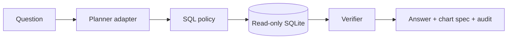

# Enterprise Data Analyst Agent

[](https://github.com/ZhengjunSun/enterprise-data-analyst-agent/actions/workflows/ci.yml)

A safe Text-to-SQL workflow over a fictional refinery dataset. It separates planning, SQL policy validation, read-only execution, result verification and chart specification.



## Capabilities

- Schema introspection and provider-neutral planner interface
- SELECT-only SQL parser with table allowlists and row limits
- Read-only database connection and query timeout
- Deterministic verification of empty, truncated and non-finite results
- Vega-Lite-style chart specifications
- Complete audit record without exposing database credentials

```bash
python -m data_analyst_agent.demo
python -m unittest discover -s tests -v
```

The database and business figures are synthetic. The built-in planner is deterministic so the project runs without an API key; an LLM can be connected through the same interface.

## License

MIT
